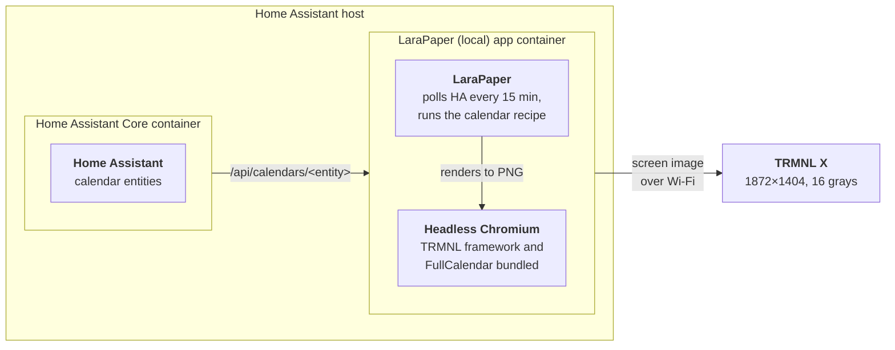

# Rolling Month Calendar on LaraPaper

This page is for running the calendar on your own TRMNL server,
[LaraPaper](https://github.com/usetrmnl/larapaper). If your TRMNL uses TRMNL's own
servers (trmnl.com), you don't need any of this: see the [README](README.md).

On LaraPaper the calendar reads **ICS feeds** or **Home Assistant** calendar entities,
and everything stays on your network. This repository also has a Home Assistant app,
**LaraPaper (local)**, that runs LaraPaper with everything the calendar needs built in,
so rendering a screen needs no internet access. LaraPaper can also run with Docker
Compose on any machine.

The [settings](README.md#settings) are the same as on TRMNL.com, apart from where the
events come from.



<sub>With Docker Compose instead of the app, the LaraPaper container runs on any machine that can reach Home Assistant.</sub>

The recipe is tested with LaraPaper 0.45.1 (the app's version) and still works with
0.43: there, ICS feeds show fewer weeks (see [ICS feeds](#ics-feeds)) and you tick
**Remove bleed margin?** yourself.

## 1. Run LaraPaper

**As a Home Assistant app (recommended).** This repository is an app repository. Go to
Settings → Apps → store → ⋮ → Repositories, add
`https://github.com/BartSchuurmans/trmnl-rolling-month-calendar`, and install
**LaraPaper (local)**. It bundles the TRMNL framework and FullCalendar, so rendering
needs no internet access, and it reads your calendars with its own Home Assistant
access, so you don't need an access token. Its web UI opens inside Home Assistant, so
you can reach it wherever you reach Home Assistant. Setup steps are in
[larapaper/DOCS.md](larapaper/DOCS.md).

**Or with Docker Compose** on any machine:

```sh
cat > .env <<EOF
APP_KEY=base64:$(openssl rand -base64 32)
APP_URL=http://<server-ip>:4567
EOF
docker compose up -d
```

Open `http://<server-ip>:4567` and register. Set your time zone in your user
settings; the calendar uses it unless you set one on the plugin.

## 2. Point the TRMNL X at it

A new TRMNL X starts in Wi-Fi pairing mode. To get back to it on one that is already set
up, hold the left and right ends of the touch bar until the screen flashes (the X has no
button on the back). Connect to the **TRMNL** Wi-Fi network it opens, tap **Advanced** →
**Custom Server** → **Yes** and enter `http://<server-ip>:4567`, without a trailing
slash. Then go **Back to Wi-Fi**, pick your network and **Connect**.

With the **Auto-Join** toggle in LaraPaper's header switched on (it then reads **Auto-Join
Permitted**; only the first registered user sees it), the device shows up by itself.
Check that its device model is **TRMNL X**. The device then shows "Please visit
trmnl.com/start with Friendly ID … to finish setup". The firmware always shows that text
after pairing, also with a custom server, so ignore it: the device is paired once it is
listed in LaraPaper, and it shows your playlist from its next refresh (tap the middle of
the touch bar to refresh now).

## 3. Find your calendars

**ICS feeds.** Most calendar services publish a private feed link (read-only, and
anyone with the link can read the calendar, so keep it private):

- Google Calendar: calendar settings → **Integrate calendar** → **Secret address in
  iCal format**
- iCloud: Calendar app → share the calendar → **Public Calendar** → copy the
  `webcal://` link
- Outlook.com / Microsoft 365: Settings → Calendar → **Shared calendars** → **Publish a
  calendar** → the ICS link
- Fastmail, Nextcloud and most CalDAV servers have a similar "subscribe" or "export"
  link

**Home Assistant.** Find your calendar entity IDs under Settings → Devices & services →
Entities (filter on `calendar.`). Any calendar integration works (Local Calendar,
Google, CalDAV, iCloud…).

**Docker Compose only:** LaraPaper needs a token to read Home Assistant. HA → your profile →
**Security** → **Long-lived access tokens** → Create. Check it from the LaraPaper host:

```sh
curl -H "Authorization: Bearer $TOKEN" \
  "http://homeassistant.local:8123/api/calendars/calendar.family?start=2026-09-21&end=2026-11-10"
```

## 4. Install the recipe

LaraPaper → **Plugins** → add menu → **Import from OSS Catalog** → **Install** on
**Rolling Month Calendar**. Then
open the settings of the **Rolling Month Calendar** recipe and fill in either:

- **ICS feed URLs**, one per calendar. When these are set, the Home Assistant fields are
  not used. Or:
- **Home Assistant calendar entities**, e.g. `calendar.family`, `calendar.work`. With
  Docker Compose also **Home Assistant URL**, e.g. `http://homeassistant.local:8123`
  (must be reachable from the LaraPaper container), and **Access token**. With the
  Home Assistant app, leave the URL at its default `http://127.0.0.1:8124` and the
  token empty: that is the app's own access to Home Assistant.

With the Home Assistant app you can also fill in **Home Assistant weather entity**, e.g.
`weather.forecast_home`, for each day's forecast next to its day number (see
[Weather](#weather)).

The calendar is made to run to the screen's edges, as it does on TRMNL.com. LaraPaper
0.44.0 and later take that from the recipe; on an older LaraPaper, tick **Remove bleed
margin?** under **Screen Settings**.

Add the recipe to the device's playlist (**Add to Playlist** on the recipe page).

**Updating:** installing from the catalog again adds a second copy. To update in place
and keep your settings, download
[`rolling-month-calendar.zip`](https://github.com/BartSchuurmans/trmnl-rolling-month-calendar/releases/latest/download/rolling-month-calendar.zip)
from the latest release and import it with **Plugins** → add menu → **Import Recipe
Archive**. The recipe keeps the same `id` (`settings.yml`), so LaraPaper replaces the
installed copy. After changing anything under `plugin/src`, build the ZIP with
`./scripts/build-zip.sh` (→ `dist/rolling-month-calendar.zip`) and import that the same
way.

## ICS feeds

LaraPaper fetches each feed on every refresh and parses it itself: recurring events are
expanded and times are converted from the feed's time zones. It keeps only events from
7 days back to 45 days ahead (30 before LaraPaper 0.44.0), so with ICS feeds the grid
ends at the last whole week before that: 6 weeks, or on an older LaraPaper usually 4
and sometimes 5. A later day would otherwise look free while its events are simply not
in the data. Home Assistant is asked for 6 weeks ahead and has no such limit.

A `webcal://` link is fetched over `https://`. The Home Assistant token is never sent
to the feeds.

## Weather

Each day from today on can get its daily forecast next to its day number (see
[Weather](README.md#weather) in the README). On LaraPaper this takes the LaraPaper
(local) app: set **Home Assistant weather entity**, and the forecast comes from that
entity. It works with ICS feeds as well as with Home Assistant calendars. Prefer Home
Assistant's Open-Meteo integration over Met.no, as the README explains.

Home Assistant gives forecasts only to a `weather.get_forecasts` service call (a POST),
and a recipe can only poll with GET. The app's proxy on `http://127.0.0.1:8124` turns
`GET /api/weather/<weather entity>` into that one call (`type: daily`), so the recipe
fetches the forecast from **Home Assistant URL** at its default. It doesn't work with
a Home Assistant URL of your own (Docker Compose).

## Offline rendering

The recipe loads FullCalendar from `/rolling-month-calendar/...`, which the LaraPaper (local)
app serves, and falls back to jsDelivr on any other server (TRMNL.com loads it from
jsDelivr straight away). With plain LaraPaper, rendering also loads the TRMNL framework
from trmnl.com, so the container needs internet access. The app avoids both. How: screens render from a
temporary `file://` page, so root-relative paths resolve to files in the image, and to
nginx in the browser preview.
