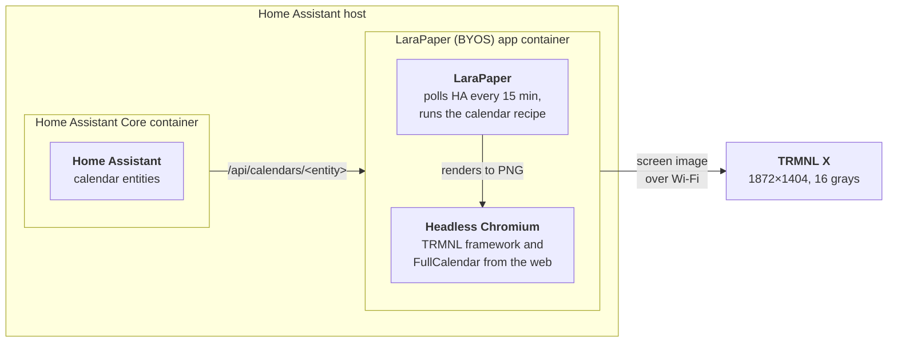

# Rolling Month Calendar on LaraPaper

This page is for running the calendar on your own TRMNL server,
[LaraPaper](https://github.com/usetrmnl/larapaper). If your TRMNL uses TRMNL's own
servers (trmnl.com), you don't need any of this: see the [README](README.md).

On LaraPaper the calendar reads **ICS feeds** or **Home Assistant** calendar entities,
and your calendars stay on your network. LaraPaper runs as the official LaraPaper app for
Home Assistant, or with Docker Compose on any machine. Rendering
a screen loads the TRMNL framework (trmnl.com) and FullCalendar (jsDelivr), so the
server needs internet access.

The [settings](README.md#settings) are the same as on TRMNL.com, apart from where the
events come from.



<sub>With Docker Compose, the LaraPaper container runs on any machine that can reach Home Assistant.</sub>

The recipe is tested with LaraPaper 0.49.0 and still works with
0.43: there, ICS feeds show fewer weeks (see [ICS feeds](#ics-feeds)) and you tick
**Remove bleed margin?** yourself. The weather needs LaraPaper 0.47.0 or later (see
[Weather](#weather)).

## 1. Run LaraPaper

**As a Home Assistant app (recommended).** Go to Settings → Apps → store → ⋮ →
Repositories, add `https://github.com/usetrmnl/trmnl-home-assistant`, and install
**LaraPaper (BYOS)**. Its web UI opens inside Home Assistant, so you can reach it
wherever you reach Home Assistant. Set its **Home Assistant key for recipes** option and
the calendar reads Home Assistant through the app, with no Home Assistant token (see
[step 4](#4-install-the-recipe)). Setup steps are in its Documentation tab.

This repository's own app, **LaraPaper (local)**, is retired: it was that app plus a few
extras, which are now part of it, apart from device sensors. If you still run it,
[move to the official app](#moving-from-the-larapaper-local-app); your devices,
playlists and settings come along.

**Or with Docker Compose** on any machine:

```sh
cat > .env <<EOF
APP_KEY=base64:$(openssl rand -base64 32)
APP_URL=http://<server-ip>:4567
EOF
docker compose up -d
```

Open `http://<server-ip>:4567` and register. Set your time zone in your user
settings; the calendar uses it unless you set one on the plugin.

## 2. Point the TRMNL X at it

A new TRMNL X starts in Wi-Fi pairing mode. To get back to it on one that is already set
up, hold the left and right ends of the touch bar until the screen flashes (the X has no
button on the back). Connect to the **TRMNL** Wi-Fi network it opens, tap **Advanced** →
**Custom Server** → **Yes** and enter `http://<server-ip>:4567`, without a trailing
slash. Then go **Back to Wi-Fi**, pick your network and **Connect**.

With the **Auto-Join** toggle in LaraPaper's header switched on (it then reads **Auto-Join
Permitted**; only the first registered user sees it), the device shows up by itself.
Check that its device model is **TRMNL X**. The device then shows "Please visit
trmnl.com/start with Friendly ID … to finish setup". The firmware always shows that text
after pairing, also with a custom server, so ignore it: the device is paired once it is
listed in LaraPaper, and it shows your playlist from its next refresh (tap the middle of
the touch bar to refresh now).

## 3. Find your calendars

**ICS feeds.** Most calendar services publish a private feed link (read-only, and
anyone with the link can read the calendar, so keep it private):

- Google Calendar: calendar settings → **Integrate calendar** → **Secret address in
  iCal format**
- iCloud: Calendar app → share the calendar → **Public Calendar** → copy the
  `webcal://` link
- Outlook.com / Microsoft 365: Settings → Calendar → **Shared calendars** → **Publish a
  calendar** → the ICS link
- Fastmail, Nextcloud and most CalDAV servers have a similar "subscribe" or "export"
  link

**Home Assistant.** Find your calendar entity IDs under Settings → Devices & services →
Entities (filter on `calendar.`). Any calendar integration works (Local Calendar,
Google, CalDAV, iCloud…).

**Official add-on or Docker Compose:** LaraPaper needs a token to read Home Assistant.
Preferably make a Home Assistant user for it that isn't an administrator, as the token
can do anything its user can. Log in as that user → your profile → **Security** →
**Long-lived access tokens** → Create. With Docker Compose, check it from the LaraPaper host:

```sh
curl -H "Authorization: Bearer $TOKEN" \
  "http://homeassistant.local:8123/api/calendars/calendar.family?start=2026-09-21&end=2026-11-10"
```

## 4. Install the recipe

LaraPaper → **Plugins** → add menu → **Import from OSS Catalog** → **Install** on
**Rolling Month Calendar**. Then
open the settings of the **Rolling Month Calendar** recipe and fill in either:

- **ICS feed URLs**, one per calendar. When these are set, the Home Assistant fields are
  not used. Or:
- **Home Assistant calendar entities**, e.g. `calendar.family`, `calendar.work`, with
  **Home Assistant URL** and **Access token**: with Docker Compose a URL the LaraPaper
  container reaches, e.g. `http://homeassistant.local:8123`, and a long-lived access
  token. In Home Assistant's LaraPaper app with
  **Home Assistant key for recipes** set, leave the URL at its default
  `http://127.0.0.1:8124` and enter that key as the token: the add-on reads Home
  Assistant with its own, read-only access, so you don't need a Home Assistant token.
  Without that key, use `http://homeassistant:8123` and a long-lived access token.

You can also fill in **Home Assistant weather entity**, e.g. `weather.forecast_home`,
for each day's forecast next to its day number (see [Weather](#weather)).

The calendar is made to run to the screen's edges, as it does on TRMNL.com. LaraPaper
0.44.0 and later take that from the recipe; on an older LaraPaper, tick **Remove bleed
margin?** under **Screen Settings**.

Add the recipe to the device's playlist (**Add to Playlist** on the recipe page).

**Updating:** installing from the catalog again adds a second copy. To update in place
and keep your settings, download
[`rolling-month-calendar.zip`](https://github.com/BartSchuurmans/trmnl-rolling-month-calendar/releases/latest/download/rolling-month-calendar.zip)
from the latest release and import it with **Plugins** → add menu → **Import Recipe
Archive**. The recipe keeps the same `id` (`settings.yml`), so LaraPaper replaces the
installed copy. After changing anything under `plugin/src`, build the ZIP with
`./scripts/build-zip.sh` (→ `dist/rolling-month-calendar.zip`) and import that the same
way.

## ICS feeds

LaraPaper fetches each feed on every refresh and parses it itself: recurring events are
expanded and times are converted from the feed's time zones. It keeps only events from
7 days back to 45 days ahead (30 before LaraPaper 0.44.0), so with ICS feeds the grid
ends at the last whole week before that: 6 weeks, or on an older LaraPaper usually 4
and sometimes 5. A later day would otherwise look free while its events are simply not
in the data. Home Assistant is asked for 6 weeks ahead and has no such limit.

A `webcal://` link is fetched over `https://`. The Home Assistant token is never sent
to the feeds.

## Weather

Each day from today on can get its daily forecast next to its day number (see
[Weather](README.md#weather) in the README): set **Home Assistant weather entity**, and
the forecast comes from that entity in the Home Assistant at **Home Assistant URL**. It
works with ICS feeds as well as with Home Assistant calendars (with ICS feeds, the
Home Assistant URL and token are only used for the weather). Prefer Home Assistant's
Open-Meteo integration over Met.no, as the README explains.

Home Assistant gives forecasts only to a `weather.get_forecasts` service call (a POST),
and a recipe can only poll with GET. So the recipe brings a transform (`transform.js`, a
script LaraPaper runs after polling, from LaraPaper 0.47.0 on) that makes that call
(`type: daily`) with your access token. An older LaraPaper doesn't run it: there the
calendar shows without the weather. The add-on's `http://127.0.0.1:8124` passes that call
on too. Transforms are on by default; if the server switched them off
(`TRANSFORM_PROVIDER`), there is no weather. (Up to recipe v2.10.0, with the LaraPaper
(local) app up to 0.47.0-2, the app's proxy turned a `GET /api/weather/<entity>` into the
call and the recipe polled that.)

## Moving from the LaraPaper (local) app

Up to November 2026 this repository had its own Home Assistant app, **LaraPaper
(local)**: the official app plus device sensors. It is retired. To move to the official
**LaraPaper (BYOS)** app and keep your data, copy three things from the old app's data
folder to the official app's (both keep their data the same way): `database/` (your
account, devices, playlists, recipes and settings), `generated/` (the screens) and
`app_key` (which unlocks the settings LaraPaper stores encrypted). Home Assistant
keeps each app's data folder to itself, so the copy runs from a terminal that can use
Docker. Your TRMNLs keep talking to port 4567, so they need no changes.

1. **Back up the old app.** Settings → System → Backups → **Create backup** → **Partial
   backup**, with only that app. Also note its options (its **Configuration**
   tab): **App URL**, **Home Assistant key for recipes** and any others you changed.
2. **Stop the old app** (**Stop** on its page).
3. **Install the official app.** Settings → Apps → store → ⋮ → **Repositories**, add
   `https://github.com/usetrmnl/trmnl-home-assistant`, then install **LaraPaper
   (BYOS)**. Don't start it yet. In its **Configuration** tab, enter the options you
   noted, and the same **Home Assistant key for recipes** in particular: your recipes
   send it as their access token.
4. **Copy the data.** Install the **Advanced SSH & Web Terminal** app (from the
   community apps), turn off its **Protection mode**, start it and click **Open Web
   UI**. Then run:

   ```sh
   img=$(docker images --format '{{.ID}} {{.Repository}}' | awk '/larapaper/ { print $1; exit }')
   docker run --rm --entrypoint sh -v /mnt/data/supervisor/apps/data:/apps "$img" -c '
     set -e; cd /apps; ls
     old=$(ls -d *_larapaper_local); new=$(ls -d *_trmnl-larapaper)
     echo "Copying $old to $new"
     rm -rf "$new/database" "$new/generated" "$new/app_key"
     cp -a "$old/database" "$old/generated" "$old/app_key" "$new/"
     ls -l "$new"'
   ```

   It lists the app data folders, then the two it copied between and what the official
   app's folder now holds; it stops before changing anything if it can't find either.
   If it can't find `*_trmnl-larapaper`, start the official app once, stop it and run
   the command again. A Supervisor from before Home Assistant renamed add-ons to apps
   keeps them in `/mnt/data/supervisor/addons/data` (on Home Assistant Supervised,
   `/usr/share/hassio/addons/data`): use that path instead if `ls` shows nothing. Afterwards, turn **Protection mode** back on
   (or uninstall the terminal app).
5. **Start the official app** and click **Open Web UI**. Log in with your usual account:
   your devices, playlists and recipes are there, and each TRMNL gets its next screen
   when it next wakes. LaraPaper updates its database to its own version as it starts.
   Its **Log** tab should say "Home Assistant for recipes on http://127.0.0.1:8124"; if
   the calendar shows "401: Unauthorized", the key differs from the one in the recipe.
6. **Remove the device sensors.** The official app has none, so the TRMNL devices under
   Settings → Devices & services → MQTT stop updating: delete each one there (⋮ →
   **Delete**).
7. **Uninstall the old app** once you're happy, and remove this repository
   (`https://github.com/BartSchuurmans/trmnl-rolling-month-calendar`) from the app store's
   repositories. Keep the backup from step 1 until then: restoring it brings the old app
   back as it was.

LaraPaper's **Pre-render playlist items** (Settings → Lab) is stored in the database, so
it comes along too.
